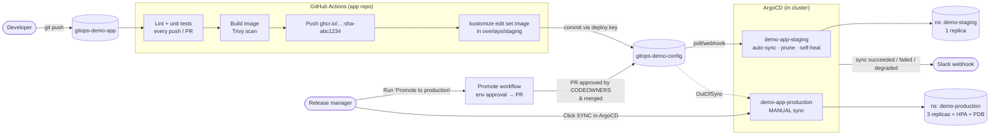

# GitOps Config Repo – `demo-app`

This repo is the **single source of truth** for what runs in the `demo-staging` and `demo-production` namespaces.
Nobody runs `kubectl apply`; ArgoCD continuously reconciles the cluster to match this repo.

| Repo | Purpose |
|---|---|
| [`gitops-demo-app`](https://github.com/jason2303/gitops-demo-app) | Application code + CI (test → build → push image → bump tag here) |
| **`gitops-demo-config`** (this repo) | Kustomize manifests, ArgoCD project/ApplicationSet/RBAC/notifications |

---

## 1. End-to-end workflow



**Step by step**

| # | What happens | Where |
|---|---|---|
| 1 | Dev pushes code. CI runs lint + tests on **every** branch and PR. | `gitops-demo-app/.github/workflows/ci.yaml` → `test` |
| 2 | On `main` only: build image, Trivy scan (fails on fixable HIGH/CRITICAL), push `ghcr.io/<user>/gitops-demo-app:sha-<7>` | `build-and-push` job |
| 3 | CI checks out *this* repo with a write deploy key, runs `kustomize edit set image` in `overlays/staging`, commits `deploy(staging): demo-app sha-…` | `update-config-repo` job |
| 4 | ArgoCD sees the new commit, **auto-syncs staging** (prune + self-heal). | `argocd/applicationset/demo-app.yaml` |
| 5 | Release manager runs **Promote to production** (Actions tab). The `production` environment requires approval; the job opens a PR that copies the staging tag into `overlays/production`. | `.github/workflows/promote.yaml` |
| 6 | PR is reviewed (CODEOWNERS) and merged. ArgoCD marks `demo-app-production` **OutOfSync** but does **not** deploy. | |
| 7 | Release manager reviews the diff in ArgoCD and clicks **Sync**. Only `role:release-manager` can do this. | `argocd/rbac/argocd-rbac-cm.yaml` |

Image tags are **immutable** (`sha-<commit>`), so every running version traces back to an exact app commit, and every deployment is a Git commit in this repo (audit trail = `git log`).

---

## 2. Repository layout

```
.
├── apps/demo-app/
│   ├── base/                      # shared: Deployment, Service, ServiceAccount, ConfigMap generator
│   └── overlays/
│       ├── staging/               # ns demo-staging, 1 replica, small resources, LOG_LEVEL=debug
│       └── production/            # ns demo-production, 3 replicas, bigger resources, HPA, PDB, spread
├── argocd/
│   ├── projects/demo-project.yaml       # AppProject: allowed repo, namespaces, resource kinds
│   ├── applicationset/demo-app.yaml     # ONE definition → staging (auto) + production (manual)
│   ├── apps/                            # equivalent plain Applications (alternative, don't apply both)
│   ├── rbac/argocd-rbac-cm.yaml         # developer vs release-manager permissions
│   └── notifications/                   # Slack webhook triggers/templates
├── scripts/                       # bootstrap, demos (drift, rollback), secrets helpers
└── .github/
    ├── workflows/validate.yaml    # kustomize build + kubeconform + "no plain Secrets" on every PR
    ├── workflows/promote.yaml     # gated promotion to production
    └── CODEOWNERS
```

### Environment differences

| Setting | base | staging | production |
|---|---|---|---|
| Namespace | – | `demo-staging` | `demo-production` |
| Replicas | 2 | **1** | **3** (HPA 3–6) |
| CPU req / limit | 50m / 200m | 25m / 100m | 100m / 500m |
| Memory req / limit | 64Mi / 128Mi | 64Mi / 128Mi | 128Mi / 256Mi |
| `LOG_LEVEL` | info | debug | warn |
| PodDisruptionBudget | – | – | minAvailable 2 |
| Topology spread | – | – | across nodes |
| Image tag updated by | – | CI (automatic) | Promote PR (manual) |
| ArgoCD sync | – | automated, prune, selfHeal | **manual** |

---

## 3. Setup

### Prerequisites
`kind` (or any cluster), `kubectl`, `kustomize` ≥ 5, `argocd` CLI, `yq`, a GitHub account.

### 3.1 Create the two repos
1. Create **public** repos `gitops-demo-app` and `gitops-demo-config` on GitHub and push the two folders.
2. In this repo: `./scripts/set-github-user.sh <your-github-username>` then commit/push.

### 3.2 Wire CI → config repo (least privilege, no PAT)
```bash
ssh-keygen -t ed25519 -N "" -f gitops-deploy-key -C "gitops-bot"
```
- **Config repo** → Settings → Deploy keys → add `gitops-deploy-key.pub`, tick **Allow write access**.
- **App repo** → Settings → Secrets and variables → Actions:
  - Secret `CONFIG_REPO_DEPLOY_KEY` = contents of `gitops-deploy-key` (private key)
  - Variable `CONFIG_REPO` = `<your-user>/gitops-demo-config`
- Delete the local key files afterwards.

The deploy key can write to **only** this one repo. Image push uses the built-in `GITHUB_TOKEN` (`packages: write`), so no long-lived registry credentials exist anywhere.

After the first successful CI run: GitHub → your profile → Packages → `gitops-demo-app` → Package settings → **Change visibility → Public** (so the cluster can pull without an imagePullSecret).

### 3.3 Protect production (config repo settings)
- **Settings → Environments → New environment `production`** → Required reviewers = you / release managers.
- **Settings → Rules → Rulesets → New branch ruleset** on `main`: require pull request + CODEOWNERS review, block force pushes. Add **Deploy keys** to the bypass list so the CI bot can push staging bumps.
- **Settings → Actions → General** → tick *Allow GitHub Actions to create and approve pull requests* (needed by the promote workflow).

### 3.4 Bootstrap the cluster
```bash
./scripts/bootstrap.sh          # kind cluster + ArgoCD + RBAC + notifications + project + ApplicationSet
kubectl -n argocd port-forward svc/argocd-server 8080:443
# open https://localhost:8080  (admin / password printed by the script)
```
Set passwords for the demo RBAC users:
```bash
argocd login localhost:8080 --username admin --insecure
argocd account update-password --account dev-alice   --new-password '<strong-pw>' --current-password '<admin-pw>'
argocd account update-password --account release-bob --new-password '<strong-pw>' --current-password '<admin-pw>'
```
Optional Slack notifications:
```bash
SLACK_WEBHOOK_URL=https://hooks.slack.com/services/XXX ./scripts/create-notification-secret.sh
# or, GitOps-friendly: ./scripts/seal-notification-secret.sh  (Sealed Secrets; output is safe to commit)
```

You should now see **demo-app-staging** (Synced/Healthy) and **demo-app-production** (OutOfSync until you sync it the first time) in the dashboard.

---

## 4. Demonstrating each requirement

### ① Code push triggers CI / ② CI builds image and updates config repo
```bash
# in gitops-demo-app
sed -i 's/Hello from the GitOps demo app/Hello v2/' app/main.py
git commit -am "feat: new greeting" && git push
```
Watch Actions: `test` → `build-and-push` → `update-config-repo`. A new commit `deploy(staging): demo-app sha-xxxxxxx` appears in this repo.

### ③ ArgoCD auto-deploys to staging
ArgoCD polls every ~3 min (click **Refresh** or `argocd app get demo-app-staging --refresh` to speed it up).
```bash
kubectl -n demo-staging get deploy demo-app -o jsonpath='{.spec.template.spec.containers[0].image}'
kubectl -n demo-staging port-forward svc/demo-app 9000:80 & curl localhost:9000
```

### ④ Manual promotion to production
1. Actions → **Promote to production** → Run workflow (blank tag = current staging tag).
2. Approve the `production` environment gate.
3. Review + merge the PR it opens.
4. ArgoCD: `demo-app-production` is **OutOfSync**. Log in as `release-bob` → **App Diff** → **Sync**.
   (Log in as `dev-alice` and try the same: the Sync is denied → RBAC works.)

### ⑤ Drift detection & self-heal
```bash
./scripts/demo-drift.sh
# kubectl scale … --replicas=5 on staging → ArgoCD reverts to 1 within seconds
```
On production the same manual change shows as **OutOfSync** (detected, *not* auto-reverted) so a human decides.

### ⑥ Rollback with `git revert`
```bash
./scripts/demo-rollback.sh staging      # reverts last staging tag bump; ArgoCD auto-deploys previous image
./scripts/demo-rollback.sh production   # reverts last promotion; then Sync in ArgoCD
```
Note: ArgoCD's own UI "Rollback" button is disabled for auto-synced apps on purpose—Git must stay the truth, so rollback is a Git revert.

---

## 5. Security summary

| Control | Implementation |
|---|---|
| No secrets in Git | Image push uses ephemeral `GITHUB_TOKEN`; cross-repo write uses a repo-scoped deploy key stored as an Actions secret; Slack URL lives in a cluster Secret or a **SealedSecret**. `validate.yaml` fails any PR that renders a plain `Secret`. |
| Production requires manual approval | 3 gates: GitHub Environment reviewer → CODEOWNERS PR review → manual ArgoCD Sync restricted to `role:release-manager`. |
| ArgoCD RBAC | `policy.default: ""` (deny by default). Developers: view + sync **staging only** (explicit deny on production). Release managers: sync both. Only admins may create/edit/delete Applications. |
| Blast-radius limits | AppProject allows only this repo as source, only the two namespaces as destinations, only `Namespace` as a cluster-scoped kind, and blocks RBAC/quotas from app manifests. |
| Workload hardening | Non-root UID 10001, read-only root FS, all capabilities dropped, seccomp `RuntimeDefault`, no SA token mounted; namespaces labeled Pod Security `restricted`. |
| Supply chain | Immutable `sha-` tags, Trivy scan blocks fixable HIGH/CRITICAL CVEs, promote workflow rejects non-sha tags, workflow inputs passed via env (no script injection). |
| Safe deletes | ApplicationSet `preserveResourcesOnDeletion: true`; `PruneLast=true`. |

## 6. Bonus items implemented
- ✅ **ApplicationSet** managing both environments from one definition (per-env sync policy via `templatePatch`)
- ✅ **Notifications** on sync success / failure / degraded health (Slack incoming webhook)
- ✅ **Sealed Secrets** workflow for the notification secret
- ➖ ArgoCD Image Updater: not used, deliberately. CI writes the tag to Git itself, which keeps an explicit commit per deploy. To try it: install Image Updater and annotate the staging app with `argocd-image-updater.argoproj.io/image-list: app=ghcr.io/<user>/gitops-demo-app` and `…/write-back-method: git`.

## 7. Screenshots
See [`docs/screenshots/`](docs/screenshots/).
